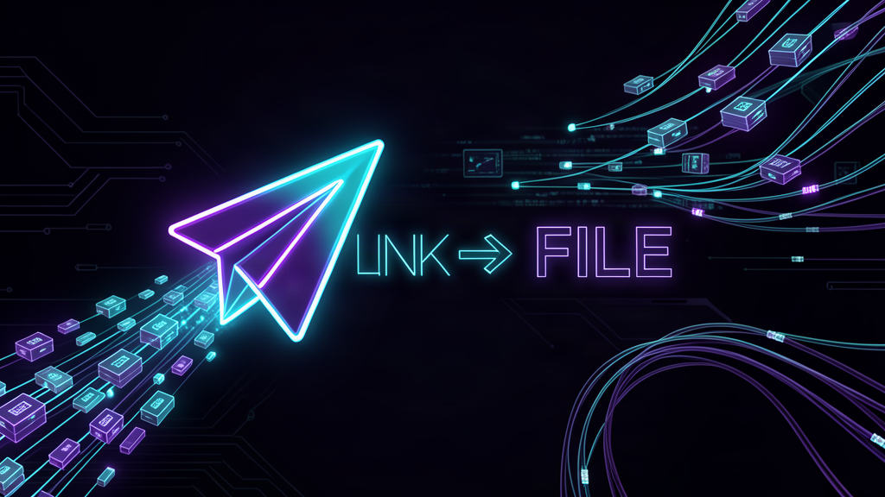
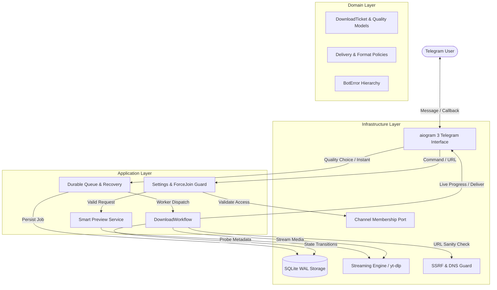

<div align="center">



# ⚡ Link → File Telegram Bot

**Production-grade, asynchronous Telegram media and file downloader bot.**  
*Paste any URL — YouTube, Instagram, TikTok, X, SoundCloud, or direct file link — and receive your file instantly.*

[](https://github.com/Opselon/Link-To-File-Telegram-Bot/actions/workflows/ci.yml)
[](https://github.com/Opselon/Link-To-File-Telegram-Bot/actions/workflows/cd.yml)
[](https://github.com/Opselon/Link-To-File-Telegram-Bot/releases/latest)
[](https://github.com/Opselon/Link-To-File-Telegram-Bot/pkgs/container/link-to-file-telegram-bot)
[](https://python.org)
[](https://docs.aiogram.dev/)
[](https://github.com/yt-dlp/yt-dlp)
[](docs/ARCHITECTURE.md)
[](LICENSE)

[Features](#-key-features) • [Architecture](#-architecture--data-flow) • [Deployment](#-deployment--quickstart) • [Configuration](#-configuration) • [Admin Suite](#-admin-suite) • [Persian Guide (فارسی)](#-راهنمای-فارسی)

</div>

---

## 🚀 Key Features

* ⚡ **Instant Lane (Zero-Wait Downloads):** High-traffic media platforms (Instagram Reels/Posts, TikTok, X/Twitter) bypass heavy metadata extraction and probe calls, routing directly to instant streaming download.
* 🎬 **Universal Provider Engine:** Powered by `yt-dlp` with support for 1,000+ streaming sites (YouTube, Instagram, TikTok, Twitter/X, SoundCloud, Reddit, Vimeo, Facebook, Pinterest, Rumble, Bilibili) alongside direct HTTP/HTTPS files.
* 🎚 **Adaptive Quality Picker:** Interactive inline keyboard offering video formats from 4K/1080p down to 144p, and audio extraction in MP3 (320kbps, 192kbps, 128kbps). Remembers your preferred quality per chat.
* 🖼 **Smart Media Previews:** Non-blocking metadata probe displays rich cards with title, uploader, duration, and thumbnail before download execution with strict sub-second deadline fallback.
* 🔄 **Durable SQLite Queue & Crash Recovery:** Jobs are durably committed to SQLite (`status = 'queued'`) *before* entering in-memory worker queues. Process restarts or host crashes automatically resume incomplete transfers without losing user requests.
* 🛡 **Fail-Closed Security & SSRF Protection:** Multi-stage SSRF validator blocks LAN IPs, private CIDR blocks, IPv4-mapped IPv6 ranges, cloud metadata endpoints (`169.254.169.254`), and loops across all redirect hops.
* 📊 **Real-Time Live Cards:** Thread-safe dynamic progress cards updating percentage, transfer speed, and ETA with a responsive single-tap cancel button (`asyncio.Task` interruption).
* 🔒 **Channel Force-Join Gate:** Dynamic channel membership enforcement configurable directly from Telegram (`/admin`), featuring 60-second caching and graceful fail-open resilience during Telegram outages.
* 📢 **Admin Broadcasting & Observability:** Live fan-out broadcast engine with flood-wait backoff, blocked-user filtering, and structured logging (`[PIPELINE:<stage>]`) for instant diagnosis.
* 🚀 **Turnkey Continuous Deployment:** GitHub Actions pipeline deploys multi-arch Docker images to GHCR and automatically updates production servers over SSH with zero downtime.

---

## 🏛 Architecture & Data Flow

Link → File is engineered strictly following **Clean Architecture**, **Domain-Driven Design (DDD)**, and **SOLID** principles. Dependencies point inward: the domain core has zero external framework dependencies.



### Module Boundary Map

```
linktofile/
├── domain/                     # Pure domain rules — zero external dependencies
│   ├── models.py               # DownloadTicket, Quality, MediaAsset, ForceJoinPolicy
│   ├── policies.py             # File size limits, timeout guards, format rules
│   ├── ports.py                # Protocols and interfaces for persistence and delivery
│   └── errors.py               # Explicit BotError domain exception hierarchy
├── application/                # Orchestration & use cases
│   ├── downloads.py            # Guard -> Fetch -> Deliver -> Teardown workflow
│   ├── queue.py                # Bounded queue runner with concurrent async workers
│   ├── recovery.py             # Startup durable queue replay & state reconciliation
│   ├── settings.py             # Force-join policies and admin configuration
│   └── active.py               # In-flight ticket registry & cancellation handles
├── infrastructure/             # Concrete implementations
│   ├── persistence/sqlite.py   # High-concurrency SQLite storage with WAL mode
│   ├── download/               # Resilient streaming HTTP engine & yt-dlp adapter
│   ├── telegram/               # aiogram handlers, keyboards, cards, and delivery
│   ├── membership.py           # Cached Telegram channel membership validator
│   ├── janitor.py              # Automated background cleanup of orphaned temp files
│   └── system/                 # SemVer versioning and metrics
├── bootstrap.py                # Single composition root (wires infrastructure to use cases)
└── main.py                     # CLI entrypoint, polling loop, and health probes
```

---

## 📦 Supported Providers

| Category | Platform | Supported Features |
|---|---|---|
| **Short Videos & Reels** | Instagram Reels / Stories / Posts | Instant Lane, High-Speed Direct Egress |
| **Short Videos** | TikTok (with/without watermark) | Instant Lane, Audio & Video extraction |
| **Social Video** | X (formerly Twitter) | Instant Lane, Multiple resolution selection |
| **Video Sharing** | YouTube (Videos, Shorts, Playlists) | 4K, 144p, MP3 audio (320k), Subtitles |
| **Music & Audio** | SoundCloud, Bandcamp | High-bitrate audio, Metadata & Artwork tags |
| **Discussions** | Reddit, Vimeo, Facebook | Merged video & audio streams |
| **Direct Links** | Any public HTTP / HTTPS URL | Resumable streaming, MIME detection |

---

## 🛠 Deployment & Quickstart

### Method 1: Turnkey One-Line Installer (Recommended)

Run on any Ubuntu/Debian server. The script auto-detects Docker, writes `.env` with strict `0600` permissions, and launches the container:

```bash
curl -fsSL https://raw.githubusercontent.com/Opselon/Link-To-File-Telegram-Bot/main/install.sh | bash
```

For non-interactive unattended installation:

```bash
BOT_TOKEN="123456:ABC-DEF1234ghIkl-zyx57W2v1u123ew11" ADMIN_ID="5094837833" \
  curl -fsSL https://raw.githubusercontent.com/Opselon/Link-To-File-Telegram-Bot/main/install.sh | bash
```

---

### Method 2: Docker Compose (GHCR Image)

1. Clone repository and set up environment:

```bash
git clone https://github.com/Opselon/Link-To-File-Telegram-Bot.git
cd Link-To-File-Telegram-Bot
cp .env.example .env
```

2. Edit `.env` with your credentials:

```ini
BOT_TOKEN=123456789:AAExampleTokenFromBotFather
ADMIN_ID=5094837833
```

3. Launch the stack:

```bash
docker compose up -d
```

The container automatically pulls the multi-architecture image from GitHub Container Registry:
`ghcr.io/opselon/link-to-file-telegram-bot:latest`

---

### Method 3: Automated Continuous Deployment (CD via GitHub Actions)

Deploy or migrate to any remote Linux server automatically upon every release or commit to `main`:

1. Configure **GitHub Secrets** in your repository settings (**Settings ➔ Secrets and variables ➔ Actions**):
   * `SERVER_HOST`: Remote server IP address (e.g. `80.47.236.99`)
   * `SERVER_PORT`: SSH port (default `22`)
   * `SERVER_USER`: SSH username (e.g. `root`)
   * `SERVER_SSH_KEY` / `SSH_PRIVATE_KEY`: Ed25519/RSA private key authorized on the server
   * `BOT_TOKEN`: Telegram bot token
   * `ADMIN_ID`: Numeric Telegram ID of the administrator
   * `YTDLP_PROXY`: (Optional) SOCKS5 or HTTP proxy URL
2. Every release publication or CI pass on `main` automatically invokes `.github/workflows/cd.yml` to pull the latest GHCR image and perform zero-downtime deployment.
3. You can also trigger deployment manually anytime via **Actions ➔ CD ➔ Run workflow**.

---

### Method 4: Bare Metal (Python Virtualenv)

Requirements: Python 3.10+, `ffmpeg`, SQLite 3.

```bash
git clone https://github.com/Opselon/Link-To-File-Telegram-Bot.git
cd Link-To-File-Telegram-Bot
python3 -m venv .venv
source .venv/bin/activate
pip install -r requirements.txt

# Run the interactive configuration wizard
python main.py --setup

# Verify token, ffmpeg, and storage connectivity
python main.py --check

# Start polling
python main.py
```

---

## ⚙ Configuration

All configuration is managed through environment variables (`.env` is automatically parsed).

| Variable | Default | Purpose & Constraints |
|---|---|---|
| `BOT_TOKEN` | *Required* | Telegram Bot API token from [@BotFather](https://t.me/BotFather) |
| `ADMIN_ID` | *Required* | Numeric Telegram ID of bot superadmin |
| `MAX_FILE_SIZE_MB` | `2000` | Hard cap on downloaded file size (1–2000 MB) |
| `QUEUE_CONCURRENCY` | `3` | Parallel download worker tasks (1–16) |
| `QUEUE_MAX_SIZE` | `200` | Maximum queue depth before signaling user busy |
| `RATE_LIMIT_SECONDS` | `3` | Per-user cooldown between consecutive requests |
| `PREVIEW_TIMEOUT` | `12` | Max seconds allowed for metadata probe (`0` disables preview) |
| `PREVIEW_WAIT` | `5` | Quality picker deadline before falling back to immediate UI |
| `RESUME_ON_STARTUP` | `1` | Replay uncompleted durable queue jobs after restarts |
| `DOWNLOAD_RETRIES` | `3` | Capped retry attempts for transient network faults |
| `RETRY_BACKOFF_SECONDS` | `2` | Initial retry backoff delay (exponential) |
| `STALL_TIMEOUT` | `120` | Seconds of silence before marking stalled connections |
| `FLOOD_WAIT_MAX` | `60` | Maximum Telegram flood wait delay absorbed by bot |
| `SSRF_ENFORCE` | `1` | Enforce fail-closed URL validation (`0` disables guard) |
| `SSRF_DNS_CHECK` | `1` | Resolve domains to ensure no private/loopback IPs |
| `YTDLP_PROXY` | — | Dedicated egress proxy for media scraping (e.g. `socks5://127.0.0.1:9050`) |
| `INSTANT_PROXY` | Direct | Dedicated proxy override for instant-lane platforms |
| `YTDLP_COOKIES_FILE` | — | Path to Netscape `cookies.txt` for bot-protected extractors |
| `TELEGRAM_API_URL` | Cloud API | Custom local Telegram Bot API endpoint for 2GB+ files |
| `DATA_DIR` | `./data` | Persistent path for SQLite DB, logs, and temp downloads |

---

## 🛠 Admin Suite

Send `/admin` to access the responsive administrator control plane:

* 📊 **Live System Metrics:** Real-time metrics including active memory usage (RSS), storage utilization, database row count, and queue load.
* 📢 **Channel Force-Join:** Enforce channel membership (`@channel_username`) before users can download media. Features instant caching and bypass protection.
* 📣 **Mass Broadcast Engine:** Distribute announcements to all users with live delivery progress, automatic flood-control handling, and detailed delivery summaries.
* 📋 **Live Queue Observer:** Inspect active jobs, elapsed time, current retry counts, and machine-readable error reasons.

---

## 🔬 Development & Quality Gates

Every pull request and release is validated against strict automated quality gates:

```bash
# 1. Install development dependencies
pip install -r requirements-dev.txt

# 2. Fast linting and syntax checking
ruff check --select E9,F .

# 3. Bytecode validation
python -m compileall -q .

# 4. Run the full pytest test suite
PYTHONPATH=. pytest -q

# 5. Build and verify multi-arch Docker image
docker build -t link-to-file:test .
docker run --rm link-to-file:test python main.py --version
```

---

## 🇮🇷 راهنمای فارسی

### راه‌اندازی سریع با یک دستور

برای نصب خودکار و اجرای ربات روی سرور لینوکس:

```bash
curl -fsSL https://raw.githubusercontent.com/Opselon/Link-To-File-Telegram-Bot/main/install.sh | bash
```

### مراحل راه‌اندازی:
۱. از طریق [@BotFather](https://t.me/BotFather) ربات تلگرام خود را ساخته و توکن آن را یادداشت کنید.  
۲. شناسه عددی خود را از طریق [@userinfobot](https://t.me/userinfobot) دریافت کنید (`ADMIN_ID`).  
۳. اسکریپت نصب را اجرا نموده و مقادیر را وارد کنید تا کانتینر داکر به صورت خودکار بیلد و اجرا شود.  
۴. برای مدیریت ربات، دستور `/admin` را ارسال نمایید.

**قابلیت‌های نسخه ۳:**
* **Instant Lane:** دانلود فوق‌سریع ریلز و پست‌های اینستاگرام، تیک‌تاک و توییتر/X بدون معطلی و انتخاب دستی کیفیت.
* **Smart Preview:** نمایش پیش‌نمایش ویدیو شامل کاور، عنوان و مدت‌زمان قبل از دانلود.
* **صف ذخیره‌شده پایدار (Durable Queue):** ذخیره درخواست‌ها در دیتابیس SQLite جهت ادامه خودکار فرآیند دانلود حتی پس از ریستارت سرور.
* **جوین اجباری:** امکان قفل کردن ربات روی کانال تلگرام با دکمه‌های شیشه‌ای تایید عضویت از طریق پنل `/admin`.

---

## 📄 License

This project is licensed under the terms of the [MIT License](LICENSE).  
Maintained by [Opselon](https://github.com/Opselon).
